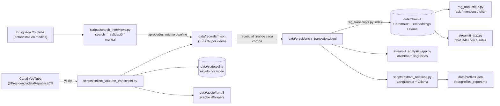

# Documentación técnica — Transcripciones Presidencia CR

> Snapshot del comportamiento real del código al **2026-08-28**. Describe lo que el sistema hace exactamente hoy, componente por componente, incluyendo defaults efectivos y el estado actual de los datos en `data/`.

## 1. Qué es este proyecto

Es un **pipeline local de recolección y análisis de discursos públicos** del canal de YouTube de la Presidencia de la República de Costa Rica (`@PresidenciadelaRepublicaCR`). Consta de tres capas:

1. **Recolección**: descubre videos y transmisiones del canal, obtiene su transcripción (subtítulos de YouTube o Whisper local) y las consolida en un archivo JSONL.
2. **Indexado y consulta (RAG)**: trocea las transcripciones, las indexa en ChromaDB con embeddings de Ollama y permite hacer preguntas en lenguaje natural (con citas a fuente y timestamp) o búsquedas literales exhaustivas.
3. **Análisis**: un dashboard de lingüística computacional (VAD, redes semánticas, polarización, entidades) y un extractor de perfiles de personas/temas con LangExtract.

Todo corre en la máquina local; los únicos servicios externos opcionales son las APIs de OpenAI y Gemini como LLM de respuesta.

## 2. Arquitectura y flujo de datos



## 3. Componentes

### 3.1 Recolector — [collect_youtube_transcripts.py](scripts/collect_youtube_transcripts.py)

CLI que descubre y transcribe videos del canal. Flujo por corrida:

1. **Descubrimiento**: lee las pestañas `/videos` y `/streams` del canal con `yt-dlp --flat-playlist --dump-single-json`, aplicando `--dateafter`/`--datebefore` si se pasaron fechas. Deduplica IDs entre pestañas.
2. **Filtro por fecha**: valida la fecha de subida de cada candidato (usa la fecha cacheada en `state.sqlite` o consulta la metadata con yt-dlp). Los videos sin fecha conocida pasan el filtro. Si encuentra **15 videos consecutivos más viejos** que `--date-after`, deja de escanear esa lista (asume orden cronológico).
3. **Procesamiento por video** ([process_video](scripts/collect_youtube_transcripts.py:642)):
   - Salta según estado previo en SQLite (ver defaults abajo: con `--force` activo por defecto, en la práctica reprocesa).
   - Videos en vivo o programados (`is_live` / `is_upcoming`) se difieren con estado `deferred_live`.
   - **Prioridad de transcripción**:
     1. Subtítulos **manuales** en español (orden: `es`, `es-419`, `es-US`, `es-ES`, variantes `a.es*`; luego cualquier idioma que empiece con `es`).
     2. Subtítulos **automáticos** (CC) en español, mismo orden.
     3. **mlx-whisper local**: descarga el mejor audio como MP3 a `data/audio/`, ejecuta el CLI `mlx_whisper` (acelerado en el GPU del Apple Silicon) con `whisper-large-v3-turbo`, idioma `es` y `condition_on_previous_text=False`, y borra el audio al terminar (salvo `--keep-audio`). El flag de no-condicionamiento evita que Whisper se salte habla de bajo volumen tras silencios largos, típico de las intros de transmisiones en vivo.
   - Los VTT se parsean a segmentos `{start, end, text}`; la limpieza quita etiquetas HTML, colapsa espacios y elimina palabras repetidas 3+ veces consecutivas (alucinaciones típicas de Whisper/CC).
   - Escribe `data/records/<video_id>.json` y marca `done` en SQLite; los errores marcan `failed` con el detalle.
4. **Consolidación**: al final de cada corrida reconstruye `data/presidencia_transcripts.jsonl` **desde cero** a partir de `data/records/`, ordenado por fecha de subida descendente. Por eso el JSONL nunca acumula duplicados.

**Robustez yt-dlp**: pasa cookies de Chrome por defecto (`--cookies-from-browser chrome`), usa `--extractor-args "youtube:player_client=default,tv_simply"` para evitar el bloqueo SABR de YouTube al descargar audio, y si falla por certificados SSL reintenta automáticamente con `--no-check-certificates` durante el resto de la corrida. El runtime JS (`--js-runtimes`) está desactivado por defecto porque no todas las versiones de yt-dlp soportan la opción.

**Defaults efectivos del código (difieren del README):**

| Flag | Default en el código | Nota |
|---|---|---|
| `--date-after` | `2026-05-01` | |
| `--whisper` | **activado** (`--no-whisper` para apagarlo) | El README original lo presentaba como opt-in |
| `--force` | **activado** (`--no-force` para apagarlo) | Reprocesa todo lo que caiga en el rango; la conducta incremental requiere `--no-force` |
| `--whisper-model` | `mlx-community/whisper-large-v3-turbo` | Repo MLX de Hugging Face |
| `--extractor-args` | `youtube:player_client=default,tv_simply` | Evita el bloqueo SABR de YouTube en descargas |
| `--js-runtimes` | `''` (desactivado) | Actívalo solo si tu yt-dlp soporta la opción |
| `--retry-no-transcript-after-hours` | `24` | Con whisper/force activos por defecto, esta ventana casi no entra en juego |

**Motor de transcripción — benchmark 2026-08-28.** Se evaluaron tres engines locales gratuitos sobre 10 minutos de la conferencia `ExwaDoCAlCE` (usando sus subtítulos manuales, reconstruidos del formato rodante, como referencia; WER normalizado sin tildes, puntuación ni muletillas; M3 Pro, 36 GB):

| Engine | Config | WER | Velocidad |
|---|---|---|---|
| **mlx-whisper** (ganador) | `large-v3-turbo` fp16, `condition_on_previous_text=False` | **7.1 %** | **~24× tiempo real** |
| faster-whisper | `large-v3-turbo` int8 CPU + VAD | 7.1 % | ~4× tiempo real |
| parakeet-mlx | `parakeet-tdt-0.6b-v3` | 92.8 % | ~46× tiempo real |

Parakeet v3 quedó descalificado: su detección automática de idioma deriva al inglés en este audio y su API no permite forzar español. Ambos Whisper en configuración por defecto se saltaban ~45 s de habla de bajo volumen tras la intro silenciosa (alucinando "Gracias."); el fix elegido para mlx-whisper fue `condition_on_previous_text=False` (equivalente en calidad al VAD de faster-whisper, 6× más rápido).

### 3.2 Motor RAG — [rag_transcripts.py](scripts/rag_transcripts.py)

CLI y a la vez biblioteca compartida (la app Streamlit delega aquí toda la lógica). Cuatro subcomandos:

- **`index`**: borra y recrea la colección `presidencia_transcripts` en `data/chroma` (ChromaDB persistente). Trocea cada transcripción respetando los límites de segmento: acumula segmentos hasta ~**2 600 caracteres** por chunk con **350 de overlap** (la cola del chunk anterior se repite al inicio del siguiente). Si un registro no tiene segmentos, corta el texto plano buscando límite en `". "`. Cada chunk guarda metadata: `video_id`, `title`, `url`, `upload_date`, `transcript_source`, `duration`, `was_live`, `chunk_index`, `start`, `end`, `timestamp` (HH:MM:SS), `timestamp_url` (URL de YouTube con `?t=<segundos>`) y `chunk_seconds`.
  Los **embeddings** los genera **Ollama** (`embeddinggemma:latest` por defecto) vía `POST /api/embed` en lotes de 128, con fallback al endpoint antiguo `/api/embeddings` uno por uno si el servidor devuelve 404.
- **`ask "<pregunta>"`**: embebe la pregunta, recupera los **top-8** chunks más cercanos y arma un prompt en español que instruye al LLM a responder **solo con el contexto**, citando fuentes como `[S1]`, `[S2]`. Imprime la respuesta y la lista de fuentes con enlaces con timestamp. Proveedores de respuesta:

  | Proveedor | Modelo por defecto | Vía |
  |---|---|---|
  | `ollama` (default) | `gemma4:12b-mlx` | `POST {host}/api/generate` |
  | `openai` | `gpt-4.1-mini` | SDK `openai` (`OPENAI_API_KEY`) |
  | `gemini` | `gemini-2.5-flash` | SDK `google-genai` (`GEMINI_API_KEY`) |

  Configurables por flags o variables de entorno: `RAG_PROVIDER`, `RAG_MODEL`, `RAG_EMBEDDING_MODEL`, `OLLAMA_HOST`.
- **`mentions "<término>"`**: búsqueda **literal exhaustiva sin LLM**. Pagina todos los chunks de la colección (páginas de 1 000), aplica una regex del término (opciones: sensible a mayúsculas, palabra completa) y devuelve cada match con ±220 caracteres de contexto, el término resaltado en negrita y su fuente. Deduplica por defecto los matches repetidos que provoca el overlap de chunks (clave: video + start + término + contexto normalizado). Límite por defecto: 500 menciones.
- **`chat`**: bucle interactivo de `ask` en terminal (se sale con `salir`/`exit`/`quit`).
- **Enriquecimiento con grafo**: si existe `data/grafos/grafo_unificado.json` (ruta configurable con `RAG_GRAPH`), `ask`/`chat`, la app de chat y los clips detectan las entidades del grafo mencionadas en la pregunta (por etiqueta o alias — p. ej. "fiscal general" resuelve a la persona Carlos Díaz) e inyectan al prompt sus relaciones más confiables con evidencia, como bloque de conocimiento estructurado. Las citas siguen anclando a `[S#]`. En la app se apaga con el toggle *Enriquecer con grafo de conocimiento*, y el bloque usado se muestra bajo cada respuesta.

Importante: **los embeddings siempre son de Ollama**, incluso cuando el LLM de respuesta es OpenAI o Gemini. Se necesita un servidor Ollama accesible (default `http://localhost:11434`) para indexar y para recuperar.

### 3.3 App de chat RAG — [streamlit_app.py](streamlit_app.py)

Interfaz web (`streamlit run streamlit_app.py`) sobre el motor anterior; no reimplementa lógica, construye un `argparse.Namespace` equivalente al CLI y llama a las funciones de `rag_transcripts`.

- **Barra lateral**:
  - Rutas configurables (JSONL, directorio ChromaDB, colección), host de Ollama y modelo de embeddings.
  - Indicador de estado del índice (número de chunks, o advertencia "Indice no encontrado").
  - Botón **"Construir / reconstruir indice"** con parámetros de chunking (tamaño, overlap, batch).
  - Selección de proveedor LLM (`ollama`/`openai`/`gemini`), modelo, temperatura (default 0.2), número de contextos (top-k, default 8) y toggle para mostrar el contexto recuperado.
  - Tipo de consulta: **"RAG"** o **"Menciones exactas"**, con opciones de menciones (mayúsculas, palabra completa, dedupe, caracteres de contexto, límite).
- **Chat**: entrada tipo chat; el historial vive en `st.session_state.history`. Cada respuesta muestra, en expanders `[S1]…`/`[M1]…`, el título del video, fecha, rango de tiempo, fuente de la transcripción, número de chunk y un botón **"Abrir referencia"** que lleva al momento exacto del video en YouTube.
- En modo RAG sin índice construido, responde con un mensaje pidiendo construir el índice primero. Los errores del LLM se muestran como texto de respuesta, sin romper la app.

### 3.4 Dashboard lingüístico — [streamlit_analysis_app.py](streamlit_analysis_app.py)

Segunda app independiente (`streamlit run streamlit_analysis_app.py --server.port 8502`). Lee el JSONL directamente (no usa ChromaDB ni LLM), todo el análisis es **en memoria con léxicos en español embebidos en el módulo**; no escribe archivos.

- **Selección**: multiselect de videos (default: el primero); el texto de los seleccionados se concatena para el análisis.
- **KPIs**: tokens, vocabulario único, type-token ratio, densidad léxica (proporción de tokens fuera de stopwords), *arousal* y dominancia.
- **Pestañas**:
  1. **Red Semántica y Comunidades**: grafo de co-ocurrencia de los top-N términos (slider 15–100, default 40) dentro de una ventana deslizante de tokens (slider 3–15, default 6), coloreado por **comunidades de Louvain**, layout spring de NetworkX, render Plotly. Incluye la tabla de aristas con pesos.
  2. **Estrategia de Discurso**: conteos de marcadores **in-group** (`nosotros`, `pueblo`, `costa rica`, `patria`…) vs **out-group** (`ellos`, `corruptos`, `comunismo`, `venezuela`, `cuba`…), balance de polarización, tasa de marcadores populistas por 1 000 tokens, y extracción de entidades (spaCy si hay modelo español instalado; si no, heurística de secuencias capitalizadas — ver observación §6.2).
  3. **Histórico Temporal**: puntuaciones **VAD** (valencia, activación, dominancia) calculadas por ventanas de **12 segmentos** de la transcripción, graficadas contra el segundo del video, con tabla que incluye timestamps.
  4. **Distribución de Frecuencias**: top de términos sin stopwords en barra horizontal.
- **Método VAD**: heurístico por léxico (`VAD_LEXICON`): cuenta apariciones de palabras clasificadas como valencia positiva/negativa, arousal o dominancia, normalizadas por `sqrt(total de tokens)`; la valencia es `positivos − negativos`. El texto se normaliza a minúsculas sin tildes antes de contar.

### 3.5 Extractor de perfiles — [extract_relations.py](scripts/extract_relations.py)

> Este script **no aparece en el README**; esta es su única documentación.

Extrae, con **LangExtract + un modelo local de Ollama** (default `qwen3.5:9b`), menciones estructuradas de personas y temas de interés definidos en [extraction_config.json](data/extraction_config.json):

- **Configuración actual**: 8 personas (Laura Fernández —"la presidente"—, Rodrigo Chaves, Efraín Célezón, Luis Salas, José Miguel Jiménez, Gabriel, Rodrigo Arias, Carlos Israel Díaz, cada una con sus alias) y 8 temas (agricultura, turismo, obra pública, contrabando, evasión de impuestos, cárceles, seguridad, justicia, cada uno con keywords).
- **Proceso**: divide cada transcripción en chunks de ~3 000 caracteres (respetando segmentos, conservando el timestamp del primero), y ejecuta LangExtract por chunk con un prompt few-shot que pide:
  - `PersonMention`: texto de la mención + atributos `role` (cargo mencionado o `n/a`) y `statement` (enunciado auto-contenido en tercera persona).
  - `ConceptMention`: término del tema + `statement`.
- **Asociación difusa**: cada extracción se asigna a la persona/tema configurado por igualdad o inclusión contra alias/keywords (mínimo 4 caracteres) y, si no, por coincidencia de palabras significativas (>3 letras, excluyendo stopwords y títulos como "señor", "presidente").
- **Salidas** (sobrescritas tras cada video y también al presionar Ctrl+C):
  - `data/profiles.json`: metadata del procesamiento (modelo, totales, `processed_video_ids` para **reanudar sin repetir videos**), y las listas de declaraciones por persona y por tema, cada una con video, fecha, timestamp y URL con marca de tiempo.
  - `data/profiles_report.md`: reporte Markdown con tablas de declaraciones por persona y por tema, enlazadas al segundo exacto del video.

### 3.6 Entrevistas en medios — [search_interviews.py](scripts/search_interviews.py)

Extiende la recolección más allá del canal oficial: busca en YouTube entrevistas de la presidente Laura Fernández dadas a medios de prensa, con **validación humana obligatoria** antes de transcribir. Tres subcomandos:

- **`search`**: ejecuta varias consultas (`ytsearch` de yt-dlp; por defecto tres variantes de "Laura Fernández entrevista", máx. 30 resultados c/u) y filtra en cascada: descarta lo ya conocido (records, `state.sqlite`, candidatos y descartes previos), títulos sin términos relevantes (laura/fernández/presidente/mandataria), clips bajo `--min-duration` (180 s), videos del canal de la Presidencia (`channel_id`) y lo fuera del rango `--date-after`/`--date-before` (default desde 2026-05-01). Los que sobreviven quedan como `pending` en `data/interview_candidates.json` con título, canal, fecha, duración y URL.
- **`review`** (interactivo: aprobar/rechazar/saltar por candidato, guardado tras cada decisión), más `approve <ids>` / `reject <ids>` por lote y `review --list` para solo listar. La misma validación existe en el frontend: la página **Entrevistas** ([pages/1_Entrevistas.py](pages/1_Entrevistas.py)) de la app principal muestra cada candidato con thumbnail, enlace a YouTube y checkbox, y su botón *Procesar seleccionados* aprueba y lanza `process` como proceso desacoplado (logs en `data/interview_process.log`); también permite lanzar búsquedas nuevas.
- **`process`**: pasa los aprobados por el **mismo `process_video` del recolector** (subtítulos → mlx-whisper, record JSON, estado SQLite; sin re-validar fecha) y reconstruye el JSONL. Marca `processed` solo si terminó `done`; si falla queda `approved` para reintentar. Los records de entrevistas conservan su canal real (`channel`/`channel_id` del medio), lo que permite distinguirlos del canal oficial en el corpus.

### 3.7 Grafos de conocimiento — [knowledge_graph.py](scripts/knowledge_graph.py)

Puente con **textgraph** (herramienta propia en `~/Documents/textgraph`; ruta configurable con `--textgraph-dir`/`TEXTGRAPH_DIR`): selecciona transcripciones del JSONL (`--videos`, `--date-after/-before`, `--search`, `--last`), las concatena con encabezado de procedencia por video (título, fecha, URL) y las pasa por el `cli.py` de textgraph, que extrae entidades y relaciones con evidencia literal y escribe en `data/grafos/` el JSON nativo, el **visor HTML autónomo** y el paquete para LLM. Motor por defecto: **`codex-cli`** (modelo default de textgraph: `gpt-5.6-sol`; para corpus largos conviene `--modelo gpt-5.6-terra`); también `gemini-cli` (CLI de Google, default `gemini-3-pro-preview`, opción barata `gemini-3-flash-preview`), `claude-cli`, `api` y `local`. Límite de textgraph: ~400k caracteres por grafo; `--dry-run` muestra selección, tamaño y llamadas estimadas sin extraer. La página **Grafo** ([pages/2_Grafo.py](pages/2_Grafo.py)) ofrece lo mismo con selección visual, estimación de costo y el visor incrustado. Verificado 2026-08-28 con motores `local` (14 nodos) y `codex-cli`/`gpt-5.6-luna` (47 nodos) sobre el mismo video.

**Batch y unificación** ([batch_graphs.py](scripts/batch_graphs.py)): genera un grafo por video rotando motores por fases (presupuesto/plazo/fallos avanzan de fase) y unifica todo en `grafo_unificado.*` con **fusión conservadora por clave normalizada** — el `resolver` heurístico de textgraph, pensado para grafos de un documento, encadena fusiones transitivas a escala de 10k+ nodos y produce meganodos (lección del 2026-08-29: uno llegó a 4,236 aliases y absorbió a Laura Fernández). La limpieza fina la hace [refine_unified_graph.py](scripts/refine_unified_graph.py): corrección de etiquetas mal transcritas por lotes (priorizadas por PageRank), poda de basura con tope por lote, y fusión de duplicados confirmada por el modelo con **guardas anti-meganodo** (tipos compatibles, ≤12 aliases, etiquetas ≤60 caracteres), con respaldo previo y tope de gasto.

### 3.8 Cortes de video — [make_clips.py](scripts/make_clips.py)

Cierra el ciclo pregunta → respuesta → **video**: el LLM responde citando `[S#]` y devuelve una sección `CITAS:` con las citas literales que respaldan la respuesta; cada cita se **alinea contra los segmentos finos del transcript** (2-8 s cada uno, por contención de palabras normalizadas con umbral 0.45) para cortar el momento exacto en que se dice — no el inicio del chunk recuperado, que puede quedar minutos antes. Si el modelo no da citas o la alineación falla, cae a un recorte centrado en el chunk. Modo alterno `--mentions "término"`: alinea y corta apariciones literales sin LLM. Cortes con `yt-dlp --download-sections` + ffmpeg (margen, duración mín/máx, ≤720p). Cada corrida escribe en `data/clips/<slug>_<fecha>/` los MP4, `manifest.json` (por clip: cita, tiempos, score de alineación, URL con timestamp) y `respuesta.md`. Con `--compilacion` los clips se unen en un **montaje** re-encodeado uniforme, en orden cronológico (`--orden fecha`, default) o de relevancia, con rótulo fecha·título sobreimpreso (`--no-rotulos` lo quita; requiere ffmpeg con filtro `drawtext` — si falta, el montaje sale sin rótulos con un aviso). La página **Clips** ([pages/3_Clips.py](pages/3_Clips.py)) lanza corridas desacopladas y reproduce los clips. Nota: los hosts de Ollama sin esquema (p. ej. `OLLAMA_HOST=0.0.0.0:11434`) se normalizan en [rag_transcripts.py](scripts/rag_transcripts.py) (`normalize_ollama_host`).

## 4. Datos y formatos

| Ruta | Qué es |
|---|---|
| `data/presidencia_transcripts.jsonl` | **Archivo maestro**: 1 línea JSON por video con `video_id`, `url`, `title`, `description`, `channel`, `channel_id`, `upload_date`, `timestamp`, `duration`, `view_count`, `live_status`, `was_live`, `transcript{source, language, text, segments[{start,end,text}]}` y `collected_at`. Se regenera completo en cada corrida del recolector. |
| `data/records/*.json` | Cache canónico: el mismo registro, un archivo por video, con formato legible. Es la fuente desde la que se reconstruye el JSONL. |
| `data/state.sqlite` | Tabla `videos(video_id PK, status, source, upload_date, title, updated_at, error)`. Estados: `discovered`, `done`, `failed`, `no_transcript`, `deferred_live`. |
| `data/audio/*.mp3` | Audios descargados para Whisper (persisten si la corrida usó `--keep-audio` o quedó interrumpida). |
| `data/chroma/` | Índice vectorial persistente de ChromaDB (colección `presidencia_transcripts`). |
| `data/interview_candidates.json` | Cola de validación de entrevistas en medios: candidatos con estado `pending` → `approved`/`rejected` → `processed`, más el mapa de descartes automáticos con su razón. |
| `data/grafos/` | Grafos de conocimiento generados con textgraph: `<slug>.json`, `<slug>.html` (visor autónomo) y `<slug>.llm.md` por grafo. |
| `data/clips/<slug>_<fecha>/` | Corridas de cortes de video: MP4 por clip citado, `manifest.json`, `respuesta.md` y `compilacion.mp4` opcional. |
| `data/extraction_config.json` | Personas (con alias) y temas (con keywords) para el extractor de perfiles. |
| `data/profiles.json` / `data/profiles_report.md` | Salidas del extractor de perfiles (JSON estructurado + reporte navegable). |

## 5. Estado actual de los datos (snapshot 2026-08-28)

- **Corpus**: 39 videos con transcripción en el JSONL (~4.5 MB). Rango de fechas de subida: **2016-05-17 → 2026-06-24**; casi todos son conferencias de prensa semanales de la Presidente y eventos oficiales. Fuentes: **36 por `whisper_base`**, **3 por subtítulos manuales de YouTube**.
- **Estado de recolección** (`state.sqlite`): 25 `done`, 22 `failed`, 3 863 `no_transcript` (el grueso del histórico del canal fue descubierto pero no tenía subtítulos y no se transcribió con Whisper en esas corridas).
- **Índice ChromaDB**: colección `presidencia_transcripts` con **248 chunks**, construida el 2026-06-26 a las 11:02. El JSONL fue regenerado después (2026-06-26 23:31), así que **el índice puede estar levemente desactualizado** respecto al corpus; reconstruir con `python scripts/rag_transcripts.py index` lo sincroniza.
- **Perfiles LangExtract**: corrida parcial con `qwen3.5:9b` — **4 de 39 videos procesados**, 67 fragmentos, **381 extracciones** (p. ej. Laura Fernández: 67 menciones; obra pública: 45; cárceles: 43). Reanudable ejecutando el script de nuevo.
- **Audio en cache**: 14 MP3 en `data/audio/`.

## 6. Observaciones sobre el comportamiento actual

Detalles donde lo que hace el código difiere de lo esperable o de lo que dice el README:

1. **Defaults agresivos del recolector**: `--force` y `--whisper` están **activados por defecto** (§3.1). Una corrida sin flags reprocesa y re-transcribe todo el rango de fechas, lo cual puede ser lento y costoso en CPU. Para la conducta incremental que describe el README hay que pasar `--no-force`.
2. **Entidades con spaCy no producen resultados**: [load_spacy_model](streamlit_analysis_app.py:123) carga el modelo con `disable=["parser", "ner"]`, pero [extract_entities](streamlit_analysis_app.py:260) lee `doc.ents`, que queda vacío con NER desactivado. Resultado actual: **si hay modelo spaCy instalado, la pestaña de entidades muestra "No se encontraron entidades"**; solo el modo heurístico (sin spaCy) devuelve entidades. Arreglo: no desactivar `ner` al cargar el modelo.
3. **Solapamiento en el léxico VAD**: `grave`, `vagabundo` y `violencia` están listados como valencia negativa **y** como arousal; al ser un dict palabra→categoría, la última asignación gana y quedan solo como *arousal*, por lo que no restan valencia.
4. **Conteo in-group/out-group por substring**: `discourse_scores` usa `str.count` sobre el texto normalizado, así que términos cortos pueden sobrecontar (p. ej. `ellos` coincide dentro de "aquellos" o "sellos").
5. **Dependencia dura de Ollama para embeddings**: aunque el LLM de respuesta sea OpenAI o Gemini, indexar y recuperar siempre pasa por el servidor Ollama (§3.2).
6. **Caché de Streamlit**: `load_records` usa `st.cache_data` por ruta; si el JSONL cambia en disco, el dashboard no lo refleja hasta limpiar la caché o reiniciar la app.

## 7. Cómo ejecutar (referencia rápida)

```bash
# Entorno
python3 -m venv .venv && source .venv/bin/activate
pip install -r requirements.txt

# 1) Recolectar transcripciones (yt-dlp + mlx-whisper por defecto)
python scripts/collect_youtube_transcripts.py --date-after 2026-05-01

# 1b) Entrevistas en medios: buscar → validar → transcribir
python scripts/search_interviews.py search
python scripts/search_interviews.py review
python scripts/search_interviews.py process

# 2) Construir el índice vectorial (requiere Ollama corriendo)
ollama pull embeddinggemma:latest
python scripts/rag_transcripts.py index

# 3a) Preguntar por CLI
python scripts/rag_transcripts.py ask "¿Qué dijo la Presidencia sobre universidades?"
python scripts/rag_transcripts.py mentions --whole-word "seguridad"

# 3b) App de chat RAG (puerto 8501)
streamlit run streamlit_app.py

# 3c) Dashboard lingüístico (puerto 8502)
streamlit run streamlit_analysis_app.py --server.port 8502

# 4) Extraer perfiles de personas/temas (requiere modelo en Ollama)
python scripts/extract_relations.py --model-id qwen3.5:9b
```

**Dependencias externas**: `yt-dlp`, `ffmpeg` (audio), servidor **Ollama** (embeddings y LLM local). Python 3.12+ en Apple Silicon: ver [requirements.txt](requirements.txt) (`mlx-whisper` para transcripción local, `chromadb`, `streamlit`, `pandas`, `plotly`, `networkx`, `spacy`, `langextract`, `openai`, `google-genai`, `yt-dlp`, `tqdm`, `requests`).
