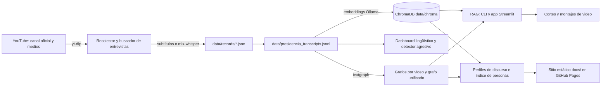

# presidencial — transcripciones y análisis del discurso de la Presidencia de Costa Rica

Pipeline **local** de código abierto que recolecta las transcripciones de los videos y transmisiones del canal
oficial de YouTube de la Presidencia de la República de Costa Rica (`@PresidenciadelaRepublicaCR`), las indexa
para hacerles preguntas con citas al segundo exacto del video, y ofrece herramientas de análisis del discurso:
dashboard de lingüística computacional, detector reproducible de lenguaje agresivo, grafos de conocimiento,
cortes de video a partir de preguntas y un sitio estático publicado con GitHub Pages
([lapeyus.github.io/presidencial](https://lapeyus.github.io/presidencial/)).

Todo corre en la máquina de quien lo usa (pensado para macOS con Apple Silicon). Los servicios externos son
opcionales: YouTube (vía `yt-dlp`) como fuente, y los LLM de OpenAI, Gemini u otros motores por CLI cuando se
eligen como proveedor de respuesta.

> La herramienta clasifica y recupera lenguaje; **no determina si una afirmación es verdadera**. Antes de
> publicar cualquier atribución, revisá el video enlazado.

## Funciones principales

| Función | Dónde | Resumen |
|---|---|---|
| Recolección de transcripciones | `scripts/collect_youtube_transcripts.py` | Descubre `/videos` y `/streams` del canal; usa subtítulos manuales → automáticos → `mlx-whisper` local; consolida un JSONL único e idempotente. |
| Entrevistas en medios | `scripts/search_interviews.py`, `pages/1_Entrevistas.py` | Busca entrevistas en otros canales y exige validación humana antes de transcribir. |
| RAG con ChromaDB | `scripts/rag_transcripts.py`, `streamlit_app.py` | Preguntas en lenguaje natural con fuentes `[S#]` y enlace al segundo; búsqueda literal exhaustiva sin LLM. |
| Dashboard lingüístico | `streamlit_analysis_app.py` | VAD heurístico, riqueza léxica, red semántica con comunidades, marcadores nosotros/ellos, línea de tiempo emocional. |
| Detector de lenguaje agresivo | `scripts/aggressive_language.py` | Reglas versionadas (`frase-agresiva-ln-ejemplos-v1`), determinista, con pruebas de regresión. |
| Grafos de conocimiento | `scripts/knowledge_graph.py`, `batch_graphs.py`, `refine_unified_graph.py`, `merge_into_unified.py`, `pages/2_Grafo.py` | Entidades y relaciones con evidencia literal usando [textgraph](https://github.com/Lapeyus/textgraph); grafo unificado con guardas anti-meganodo. |
| Cortes y montajes de video | `scripts/make_clips.py`, `scripts/clip_episode.py`, `pages/3_Clips.py`, `pages/4_Editor.py` | Alinea citas contra los segmentos del transcript y corta el momento exacto con `yt-dlp` + `ffmpeg`. |
| Perfiles y sitio estático | `scripts/discourse_profiles.py` … `scripts/build_site.py`, `docs/` | Perfiles map-reduce por persona y tema, directorio exhaustivo de personas, estudio de tensiones por tema, sitio en `docs/`. |
| Estudios léxicos | `scripts/analyze_popular_register.py`, `scripts/find_displacement_gaps.py`, `scripts/extract_relations.py` | Registro popular por género discursivo; barrido de desplazamiento de responsabilidad; menciones con LangExtract. |

## Arquitectura en breve



Detalle completo en [docs/ARCHITECTURE.md](docs/ARCHITECTURE.md).

## Inicio rápido

### Requisitos

- macOS con Apple Silicon (lo exige `mlx-whisper`; sin él, se puede correr con `--no-whisper`).
- Python 3.12+ (las dependencias MLX no soportan 3.9).
- `yt-dlp` (se instala con `requirements.txt`) y `ffmpeg` (audio, cortes y montajes).
- [Ollama](https://ollama.com) local para embeddings (`embeddinggemma:latest`) y, si se desea, como LLM.
- Opcional: claves de OpenAI o Gemini; CLIs de modelos (`codex`, `gemini`, `agy`, `claude`) para los grafos y
  perfiles; una copia local de [textgraph](https://github.com/Lapeyus/textgraph).

### Instalación

```bash
python3.12 -m venv .venv
source .venv/bin/activate
pip install -r requirements.txt
python -m spacy download es_core_news_sm   # opcional, NER en español
ollama pull embeddinggemma:latest
```

### Flujo mínimo

```bash
# 1) Recolectar (incremental: --no-force; ver nota de defaults abajo)
python scripts/collect_youtube_transcripts.py --date-after 2026-05-01 --no-force

# 2) Indexar en ChromaDB (requiere Ollama corriendo)
python scripts/rag_transcripts.py index

# 3) Preguntar o buscar literalmente
python scripts/rag_transcripts.py ask "¿Qué dijo la Presidencia sobre universidades?"
python scripts/rag_transcripts.py mentions --whole-word "seguridad nacional"

# 4) Interfaces web
streamlit run streamlit_app.py                               # chat RAG + Entrevistas, Grafo, Clips, Editor (8501)
streamlit run streamlit_analysis_app.py --server.port 8502   # dashboard lingüístico
```

> **Defaults del recolector:** `--whisper` y `--force` están **activados por defecto**. Una corrida sin flags
> reprocesa y re-transcribe todo el rango de fechas. Para el comportamiento incremental usá `--no-force`; para no
> transcribir con Whisper, `--no-whisper`.

### Recetas frecuentes

```bash
# Recolector
python scripts/collect_youtube_transcripts.py --date-after 2026-05-01 --date-before 2026-05-27
python scripts/collect_youtube_transcripts.py --retry-failed --date-after 2026-05-01
python scripts/collect_youtube_transcripts.py --cookies-from-browser "chrome:Profile 1" --date-after 2026-05-01
python scripts/collect_youtube_transcripts.py --no-browser-cookies --date-after 2026-05-01
python scripts/collect_youtube_transcripts.py --no-check-certificates --date-after 2026-05-01

# Entrevistas en medios: buscar → validar → transcribir
python scripts/search_interviews.py search
python scripts/search_interviews.py review
python scripts/search_interviews.py process

# RAG con otro proveedor
python scripts/rag_transcripts.py ask --provider gemini --model gemini-2.5-flash "¿Qué fechas se mencionan?"
python scripts/rag_transcripts.py chat --provider ollama

# Lenguaje agresivo (JSON auditable)
python scripts/aggressive_language.py --date-after 2026-05-01
python scripts/aggressive_language.py --video-id g4-Ymq8IAeo --output -

# Grafos (el motor "local" no usa modelo)
python scripts/knowledge_graph.py --search "100 días" --dry-run
python scripts/knowledge_graph.py --last 1 --motor local

# Cortes de video
python scripts/make_clips.py "¿Qué ha dicho la presidente sobre el fiscal general?" --compilacion
python scripts/make_clips.py --mentions "fiscal general" --clips 6   # sin LLM
```

La referencia completa de cada CLI (argumentos, defaults, salidas) está en [docs/SPEC.md](docs/SPEC.md).

## Estructura del repositorio

```text
.
├── scripts/
│   ├── collect_youtube_transcripts.py  # recolector del canal oficial (yt-dlp + mlx-whisper)
│   ├── search_interviews.py            # entrevistas en medios con validación humana
│   ├── rag_transcripts.py              # índice ChromaDB, ask/mentions/chat, enriquecimiento con grafo
│   ├── aggressive_language.py          # detector reproducible de frases agresivas
│   ├── analyze_popular_register.py     # registro popular por género discursivo
│   ├── extract_relations.py            # menciones de personas/temas con LangExtract + Ollama
│   ├── knowledge_graph.py              # puente con textgraph (un grafo por selección)
│   ├── batch_graphs.py                 # un grafo por video rotando motores + unificación
│   ├── refine_unified_graph.py         # limpieza asistida del grafo unificado
│   ├── merge_into_unified.py           # suma videos nuevos al unificado limpio
│   ├── make_clips.py                   # cortes y montajes desde preguntas o menciones
│   ├── clip_episode.py                 # montaje exhaustivo de un episodio descrito
│   ├── discourse_profiles.py           # perfiles map-reduce por persona y tema
│   ├── augment_references.py           # referencias exhaustivas y tono por declaración
│   ├── build_people_index.py           # directorio exhaustivo de personas (sin LLM)
│   ├── disambiguate_people.py          # persona / cargo / colectivo
│   ├── merge_people.py                 # curaduría manual del directorio
│   ├── discourse_studies.py            # estudio de tensiones por tema
│   ├── find_displacement_gaps.py       # barrido de desplazamiento de responsabilidad
│   ├── fetch_photos.py                 # retratos con licencia libre desde Wikipedia
│   └── build_site.py                   # genera el sitio estático en docs/
├── streamlit_app.py                    # app principal: chat RAG (multipágina)
├── pages/                              # 1_Entrevistas, 2_Grafo, 3_Clips, 4_Editor
├── streamlit_analysis_app.py           # dashboard lingüístico
├── tests/                              # unittest (sin red ni modelos)
├── docs/
│   ├── index.html, temas.html, personas.html, .nojekyll   # sitio GitHub Pages (generado)
│   ├── data/personas/<slug>.json       # fichas por persona (generadas)
│   ├── fotos/                          # retratos + creditos.json (licencias)
│   ├── ARCHITECTURE.md, SPEC.md, TESTING.md               # documentación técnica
├── DOCUMENTACION.md                    # apuntador a docs/ (documento histórico integrado)
├── requirements.txt                    # dependencias Python
└── package.json, package-lock.json     # dependencia Node auxiliar; el pipeline Python no la usa
```

## Configuración

No hay archivos de configuración versionados con secretos. Variables de entorno reconocidas (sin valores):

| Variable | Uso | Default |
|---|---|---|
| `RAG_PROVIDER` | Proveedor de respuesta: `ollama`, `openai`, `gemini` | `ollama` |
| `RAG_MODEL` | Modelo de respuesta | por proveedor (`gemma4:12b-mlx`, `gpt-4.1-mini`, `gemini-2.5-flash`) |
| `RAG_EMBEDDING_MODEL` | Modelo de embeddings en Ollama | `embeddinggemma:latest` |
| `RAG_GRAPH` | Grafo usado para enriquecer respuestas | `data/grafos/grafo_unificado.json` |
| `OLLAMA_HOST` | Servidor Ollama (acepta `0.0.0.0:11434`, se normaliza) | `http://localhost:11434` |
| `OPENAI_API_KEY` | Solo si se usa `--provider openai` | — |
| `GEMINI_API_KEY` | Solo si se usa `--provider gemini` | — |
| `TEXTGRAPH_DIR` | Copia local de textgraph | ruta local fija en el código: **definila** |

Todo lo que genera el pipeline vive en `data/` (excluido por `.gitignore`): corpus, audio, índice, grafos,
clips, perfiles y estado. Se reconstruye corriendo el pipeline; no hay datos del corpus en el repositorio, salvo
las fichas públicas del sitio (`docs/data/`).

El recolector pasa por defecto las cookies del perfil de Chrome a `yt-dlp` (`--cookies-from-browser chrome`) y
`--extractor-args "youtube:player_client=default,tv_simply"` para evitar el bloqueo SABR al descargar audio.

## Pruebas

```bash
.venv/bin/python -m unittest discover -s tests -v
```

33 pruebas, sin red, sin modelos y sin servicios externos (resultado al 2026-10-25: todas pasan). Detalle en
[docs/TESTING.md](docs/TESTING.md).

## Operación

No hay tareas programadas ni despliegue en servidor: todo se ejecuta a mano en la máquina local. El recolector es
idempotente (estado en `data/state.sqlite` y JSONL reconstruido desde `data/records/`), así que puede correrse
repetidamente. El sitio estático se regenera con `python scripts/build_site.py` y se publica haciendo commit de
`docs/` (GitHub Pages sirve esa carpeta).

## Documentación

- [docs/ARCHITECTURE.md](docs/ARCHITECTURE.md): contexto, componentes, flujos, secuencias, despliegue y decisiones.
- [docs/SPEC.md](docs/SPEC.md): requisitos RF/RNF, contratos de cada CLI y app, formatos de datos, trazabilidad.
- [docs/TESTING.md](docs/TESTING.md): estrategia, inventario de suites y brechas.

## Estado y limitaciones conocidas

- Pensado para Apple Silicon: `mlx-whisper`, la ruta de `ffmpeg` (`/opt/homebrew/bin/ffmpeg`) y la fuente de los
  rótulos (`/System/Library/Fonts/Helvetica.ttc`) en el editor son específicos de macOS.
- Los embeddings **siempre** pasan por Ollama, aunque el LLM de respuesta sea OpenAI o Gemini.
- Con un modelo spaCy instalado, la extracción de entidades del dashboard queda vacía porque el modelo se carga
  con `ner` desactivado; solo el modo heurístico devuelve entidades.
- El léxico VAD tiene palabras en dos categorías (gana la última) y el conteo nosotros/ellos usa subcadenas
  (`ellos` cuenta dentro de `aquellos`).
- El dashboard cachea el JSONL por ruta: tras recolectar, hay que limpiar la caché o reiniciar la app.
- `hablante` y `blanco` del detector agresivo son pistas heurísticas: las transcripciones no tienen diarización.
- Los scripts que usan modelos (perfiles, tono, desambiguación, estudios, limpieza de grafos) tienen tope de gasto
  (`--max-usd`) y son reanudables, pero sus resultados dependen del modelo y no son deterministas.
