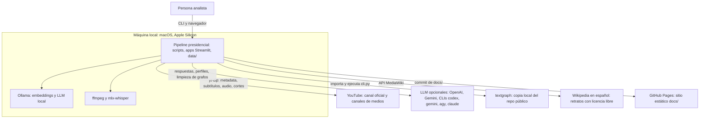
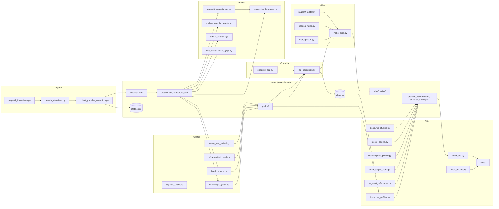
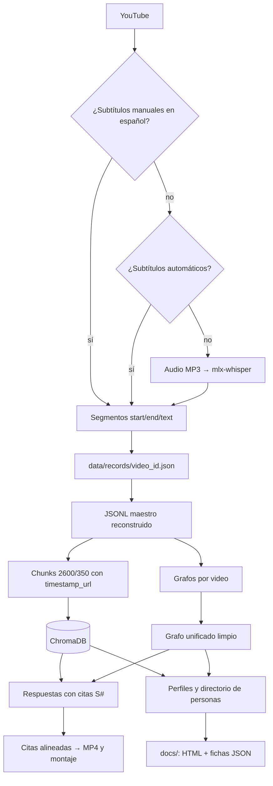
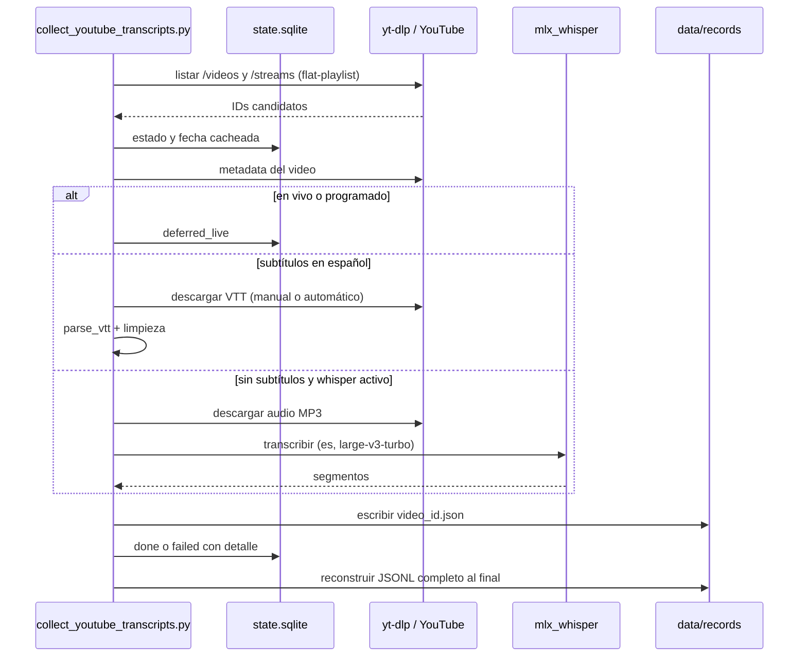
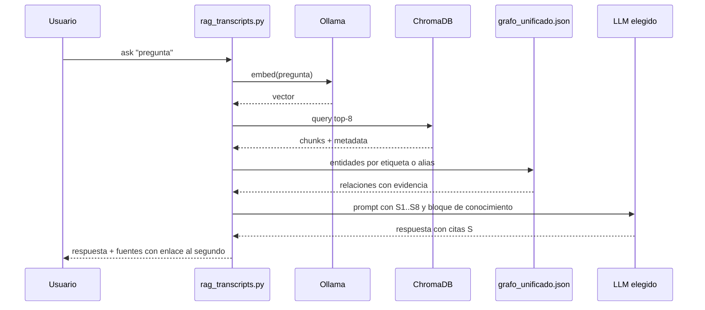
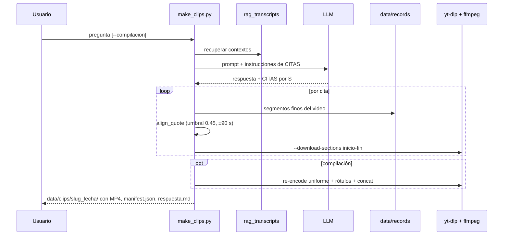

# Arquitectura

Este documento describe cómo está construido el pipeline: actores y sistemas externos, componentes, flujos de
datos, secuencias clave, dónde corre cada pieza y las decisiones de diseño que se ven en el código y en el
historial. Integra y actualiza la antigua `DOCUMENTACION.md` (instantánea técnica del 2026-08-28).

## 1. Contexto

| Actor o sistema | Rol | Obligatorio |
|---|---|---|
| YouTube | Fuente de videos, subtítulos y audio, accedida con `yt-dlp` (con cookies de Chrome por defecto). | Sí, para recolectar y cortar. |
| Ollama | Embeddings (`embeddinggemma:latest`) para indexar y recuperar; LLM local por defecto (`gemma4:12b-mlx`). | Sí, para el RAG. |
| mlx-whisper / ffmpeg | Transcripción local cuando no hay subtítulos; audio, cortes y montajes. | Según función. |
| OpenAI / Gemini (SDK) | Proveedores alternativos de respuesta del RAG (`OPENAI_API_KEY`, `GEMINI_API_KEY`). | No. |
| CLIs de modelos (`codex`, `gemini`, `agy`, `claude`) | Motores de textgraph para grafos, perfiles, tono, desambiguación, estudios y limpieza. | No (hay motores `local` y `ollama`). |
| textgraph | Extracción de grafos con evidencia literal; también se importan sus módulos `llm`, `model`, `normalize`, `store`, `exporters`, `analysis`. | Para grafos y perfiles. |
| Wikipedia | Retratos y créditos de licencia para el sitio (`scripts/fetch_photos.py`). | No. |
| GitHub Pages | Sirve `docs/` (`.nojekyll`). | No. |

## 2. Componentes

### 2.1 Ingesta

- **Recolector** (`scripts/collect_youtube_transcripts.py`). Descubre IDs en `/videos` y `/streams` con
  `yt-dlp --flat-playlist --dump-single-json` (aplicando `--dateafter/--datebefore`), deduplica, valida la fecha de
  cada candidato (cacheada en SQLite o consultada) y deja de escanear una lista tras **15 videos consecutivos más
  viejos** que `--date-after`. Por video: difiere transmisiones en vivo o programadas (`deferred_live`); elige
  subtítulos **manuales** en español (`es`, `es-419`, `es-US`, `es-ES`, variantes `a.es*`, luego cualquier `es*`),
  luego **automáticos**, y por último descarga el audio y ejecuta `mlx_whisper` con `whisper-large-v3-turbo`,
  idioma `es` y `condition_on_previous_text=False` (borra el audio salvo `--keep-audio`). Los VTT se convierten
  en segmentos `{start, end, text}` limpiando etiquetas y repeticiones de 3+ palabras iguales. Escribe
  `data/records/<video_id>.json`, marca el estado en `data/state.sqlite` y, al final de cada corrida,
  **reconstruye desde cero** `data/presidencia_transcripts.jsonl` ordenado por fecha descendente.
  Robustez: cookies de Chrome por defecto, `--extractor-args youtube:player_client=default,tv_simply` contra el
  bloqueo SABR, y reintento automático con `--no-check-certificates` si falla por certificados SSL.
- **Entrevistas en medios** (`scripts/search_interviews.py` y `pages/1_Entrevistas.py`). Búsquedas `ytsearch`
  con filtros en cascada (ya conocido, títulos irrelevantes, duración < 180 s, canal oficial, fuera de rango).
  Los candidatos quedan `pending` en `data/interview_candidates.json`; **nada se transcribe sin aprobación**.
  `process` reutiliza el mismo `process_video` del recolector; los records conservan el canal real del medio.

### 2.2 Consulta (RAG)

- **Motor** (`scripts/rag_transcripts.py`), CLI y biblioteca compartida por las apps. `index` recrea la colección
  `presidencia_transcripts` en `data/chroma` con chunks de ~2 600 caracteres y 350 de solapamiento que respetan
  los límites de segmento; cada chunk guarda `video_id`, título, fecha, fuente, `start/end`, `timestamp` y
  `timestamp_url` (`?t=<segundos>`). Embeddings con Ollama `POST /api/embed` en lotes de 128, con respaldo a
  `/api/embeddings` uno por uno si el servidor responde 404.
- `ask` recupera los top-8 chunks y arma un prompt que obliga a responder **solo con el contexto** y citar
  `[S#]`. `mentions` pagina toda la colección y aplica una expresión regular (sin LLM), deduplicando las
  coincidencias que produce el solapamiento. `chat` es el bucle interactivo.
- **Enriquecimiento con grafo**: si existe `data/grafos/grafo_unificado.json` (o `RAG_GRAPH`), se detectan las
  entidades del grafo mencionadas en la pregunta por etiqueta o alias (mínimo 4 caracteres, desempate por
  PageRank) y se inyectan sus relaciones más confiables (explícita > implícita > coocurrencia) como bloque de
  conocimiento, sin reemplazar las citas `[S#]`. El índice del grafo se cachea por `mtime`.
- **App de chat** (`streamlit_app.py`): construye un `argparse.Namespace` equivalente y delega en el motor; barra
  lateral con rutas, estado del índice, botón de reconstrucción, proveedor, modelo, temperatura, top-k, modo RAG o
  menciones, y toggle del grafo. Es multipágina: `pages/1_Entrevistas.py`, `2_Grafo.py`, `3_Clips.py`,
  `4_Editor.py`.

### 2.3 Análisis

- **Dashboard lingüístico** (`streamlit_analysis_app.py`): análisis en memoria con léxicos versionados. KPIs
  (tokens, vocabulario, TTR, densidad léxica, arousal, dominancia) y pestañas: red semántica de coocurrencias con
  comunidades de Louvain; estrategia de discurso (marcadores nosotros/ellos, populismo por 1 000 tokens,
  entidades); lenguaje de confrontación; histórico VAD por ventanas de 12 segmentos; frecuencias.
- **Detector de lenguaje agresivo** (`scripts/aggressive_language.py`, versión `frase-agresiva-ln-ejemplos-v1`):
  la unidad es la **cláusula** que caracteriza negativamente a un blanco identificable mediante una de ocho
  familias (animalización; enfermedad o suciedad; ridiculización; deshonestidad o ilegitimidad; criminalización;
  incapacidad; parasitismo o privilegio; enemigo o amenaza). Determinista: normaliza conservando offsets, aplica
  reglas contextuales con exclusiones (negaciones, usos literales), une marcas de una misma cláusula en un solo
  evento multicategoría y deduplica repeticiones equivalentes dentro de 75 s. `semantic_candidates` es una capa de
  **descubrimiento** (ChromaDB + grafo) que no altera los conteos.
- **Registro popular** (`scripts/analyze_popular_register.py`): densidad de refranes, regionalismos,
  diminutivos y metáforas por género discursivo (cadena nacional, conferencia, entrevista, evento) y cinco
  marcadores (marcado metalingüístico, anclaje biográfico, concentración funcional, repertorio cerrado, salto de
  registro). Sin LLM. Salida `data/registro_popular.json`.
- **Extractor de menciones** (`scripts/extract_relations.py`): LangExtract + Ollama (`qwen3.5:9b` por defecto)
  sobre chunks de ~3 000 caracteres; personas y temas definidos en un archivo local
  `data/extraction_config.json`; asociación difusa por alias o keywords; salidas reanudables
  `data/profiles.json` y `data/profiles_report.md`.
- **Barrido de desplazamiento de responsabilidad** (`scripts/find_displacement_gaps.py`): marcadores léxicos de
  siete formas (agencialidad asimétrica, eslabón roto, triangulación, teatralización del desaire, imposibilidad
  estructural, deslegitimación, prolepsis); descarta pasajes cercanos (±420 s) a casos ya catalogados en un
  archivo local de entrada y confirma el resto con un modelo. Salida `data/desplazamiento_nuevos.json`.

### 2.4 Grafos de conocimiento

- `scripts/knowledge_graph.py`: selecciona transcripciones (`--videos`, fechas, `--search`, `--last`), las
  concatena con encabezado de procedencia y llama al `cli.py` de textgraph (máximo 398 000 caracteres). Escribe
  JSON, visor HTML autónomo y paquete para LLM en `data/grafos/`.
- `scripts/batch_graphs.py`: un grafo por video rotando motores por **fases** (gemini-cli con presupuesto,
  antigravity-cli, ollama, codex-cli tras N horas, ollama de remate con pausas de 30 min); hasta 3 intentos por
  video; un grafo de 0 nodos cuenta como fallo; reanudable; estado en `data/grafos/batch_estado.json`. Al final
  unifica en `data/grafos/grafo_unificado.*` con **fusión conservadora por clave normalizada**.
- `scripts/refine_unified_graph.py`: respaldo previo; corrección de etiquetas por lotes priorizados por PageRank
  (con tope de poda de basura del 20 % por lote); fusión de duplicados por reglas y luego asistida por modelo con
  guardas anti-meganodo; recálculo de métricas y exportación. Tope de gasto `--max-usd`.
- `scripts/merge_into_unified.py`: suma grafos por video nuevos al unificado **limpio** sin perder la curaduría.

### 2.5 Video

- `scripts/make_clips.py`: el LLM responde con `[S#]` y una sección `CITAS:`; cada cita se **alinea contra los
  segmentos finos** del transcript (contención de palabras normalizadas, umbral 0,45, búsqueda en ±90 s del chunk)
  para cortar el momento exacto con `yt-dlp --download-sections` + `ffmpeg` (≤ 720p). Sin cita alineable, recorte
  centrado en el chunk. `--mentions` corta apariciones literales sin LLM. `--compilacion` une los clips en orden
  cronológico o de relevancia, con rótulo fecha · título si `ffmpeg` trae `drawtext`.
- `scripts/clip_episode.py`: reúne todas las menciones candidatas de un episodio descrito en lenguaje natural,
  un modelo confirma cuáles refieren a él, y se cortan y montan en orden cronológico.
- `pages/4_Editor.py` (Sala de Edición): busca segmentos (RAG, menciones o episodio), descarga cada clip una vez
  con colchón y permite recortar con sliders sin re-descargar, ordenar, añadir rótulos de dos líneas (PNG +
  overlay, sin depender de `drawtext`) y separadores, y renderizar el montaje. Proyectos en `data/editor/`.

### 2.6 Perfiles y sitio estático

Cadena de scripts que produce el sitio en `docs/`:

1. `discourse_profiles.py`: perfiles **map-reduce** por persona (nodos PERSONA del grafo unificado) y tema
   (nodos CONCEPTO): *map* por lotes de evidencias, *reduce* con síntesis de cargo, clasificación del trato
   (aliado, adversario, culpado, funcionario, neutral, mixto) o postura del tema. Reanudable, con `--max-usd`.
2. `augment_references.py`: referencias exhaustivas por entidad (sin LLM) y tono por declaración (con LLM).
3. `build_people_index.py`: directorio exhaustivo de todas las personas del grafo con descripción, relaciones y
   referencias, sin LLM (`data/personas_index.json`).
4. `disambiguate_people.py`: clasifica entradas como persona, cargo, colectivo u otro y fusiona cargos que
   designan claramente a una persona del catálogo. `merge_people.py` permite fusiones manuales.
5. `discourse_studies.py`: estudio `contradicciones` (cambio de postura, promesa vs. acción, cifras
   inconsistentes, tensión retórica), cada hallazgo anclado a dos declaraciones fechadas.
6. `fetch_photos.py`: retratos de Wikipedia con verificación de apellido y créditos de licencia en
   `docs/fotos/creditos.json`; no sobrescribe fotos existentes.
7. `build_site.py`: genera `docs/index.html` (resumen), `docs/temas.html`, `docs/personas.html` y una ficha JSON
   por persona en `docs/data/personas/<slug>.json` (se borra y regenera la carpeta en cada corrida).

## 3. Flujo de datos

## 4. Secuencias clave

### 4.1 Recolección de un video

### 4.2 Pregunta RAG con enriquecimiento por grafo

### 4.3 Corte de clips desde una pregunta

## 5. Modelo de despliegue

| Pieza | Dónde corre | Cómo se inicia |
|---|---|---|
| Scripts CLI | Máquina local (macOS, Apple Silicon) | A mano, desde el `.venv` del repo. |
| App de chat RAG + páginas | Máquina local, Streamlit, puerto 8501 | `streamlit run streamlit_app.py` |
| Dashboard lingüístico | Máquina local, Streamlit, puerto 8502 | `streamlit run streamlit_analysis_app.py --server.port 8502` |
| Procesos largos desde la UI | Máquina local, procesos desacoplados | Lanzados por las páginas Entrevistas, Clips y Grafo (sobreviven al servidor Streamlit). |
| Ollama | Máquina local o host configurable | `OLLAMA_HOST` |
| Sitio estático | GitHub Pages, carpeta `docs/` | Commit de los archivos generados por `build_site.py`. |

No hay servidores propios, contenedores, tareas programadas ni infraestructura en la nube asociada a este repo.

## 6. Dependencias externas y cuotas

- **YouTube**: sin API key; `yt-dlp` puede toparse con bloqueos (SABR) o exigir cookies; el recolector pasa las
  del perfil de Chrome por defecto.
- **Ollama**: obligatorio para embeddings, aun con OpenAI o Gemini como LLM.
- **LLM de pago o con cuota**: los scripts que llaman modelos calculan un **coste equivalente** reportado por
  textgraph y se detienen en `--max-usd` (defaults: 25 en perfiles, 15 en limpieza, 8 en tono y en el barrido de
  desplazamiento, 6 en desambiguación y estudios, 5 en la fase gemini del batch). Tres fallos seguidos se tratan
  como cuota agotada.
- **textgraph**: límite de ~400 000 caracteres por grafo.
- **Wikipedia**: API pública con `User-Agent` identificado.

## 7. Decisiones de diseño

| Decisión | Motivo (código e historial) |
|---|---|
| `mlx-whisper` con `large-v3-turbo` y `condition_on_previous_text=False` | Benchmark del 2026-08-28 sobre 10 min de una conferencia (M3 Pro): WER 7,1 % a ~24× tiempo real, igual calidad que faster-whisper con VAD (~4×) y muy superior a parakeet-mlx (92,8 %, deriva al inglés). Sin ese flag, Whisper se saltaba ~45 s de habla tras intros silenciosas. |
| JSONL reconstruido desde `data/records/` en cada corrida | El JSONL nunca acumula duplicados y el recolector es idempotente. |
| Embeddings siempre con Ollama | Índice local y gratuito, independiente del proveedor de respuesta. |
| Detector agresivo determinista; capa semántica solo de descubrimiento | Resultados comparables en el tiempo: una formulación nueva entra al conteo solo con regla explícita y prueba de regresión. |
| Validación humana de entrevistas | Evitar transcribir videos ajenos o irrelevantes encontrados por búsqueda. |
| Fusión conservadora por clave en el grafo unificado | El resolver heurístico de textgraph, pensado para un documento, encadenaba fusiones transitivas a escala de 10k+ nodos y creaba meganodos (2026-08-29: uno llegó a 4 236 alias). La limpieza fina queda en `refine_unified_graph.py` con guardas (tipos compatibles, ≤ 12 alias, etiquetas ≤ 60 caracteres). |
| `merge_into_unified.py` en vez de `--solo-unificar` | Reconstruir desde cero descarta correcciones, poda y fusiones ya aplicadas. |
| Rotación de motores por fases con tope de gasto | Repartir el trabajo largo entre cuotas gratuitas o baratas y terminar siempre con un motor local. |
| Alineación de citas contra segmentos finos | El inicio del chunk recuperado puede quedar minutos antes de la frase; los segmentos (2-8 s) dan el segundo exacto. |
| `.gitignore` anclado a `/data/` | Excluir el corpus local sin excluir `docs/data/` (fichas públicas del sitio). |
