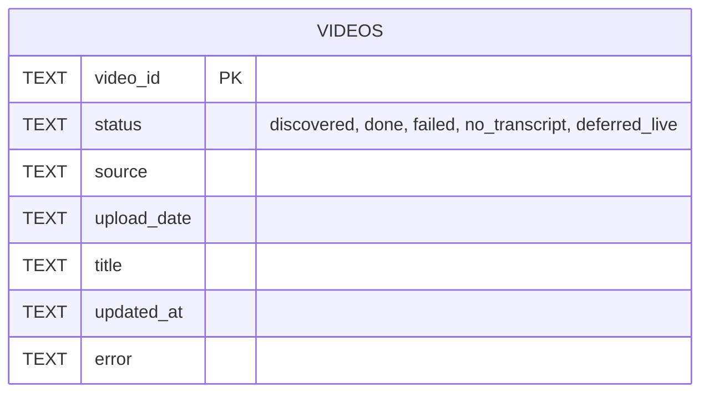

# Especificación (spec-driven development)

Especificación verificable del comportamiento actual del código. Cada requisito tiene un identificador, el módulo
que lo implementa y, cuando existe, la prueba que lo cubre (ver §6).

## 1. Propósito y alcance

**Propósito.** Construir y analizar un corpus de transcripciones del discurso público de la Presidencia de la
República de Costa Rica, con trazabilidad de cada afirmación a su video y segundo exacto.

**Dentro del alcance:** recolección desde YouTube (canal oficial y entrevistas validadas en medios),
transcripción local, indexado vectorial, consulta con citas, búsqueda literal, análisis lingüístico, detección de
lenguaje agresivo, grafos de conocimiento, cortes de video y generación de un sitio estático.

**Fuera del alcance:** verificar la veracidad de lo dicho; diarización (identificación de hablantes); servicio
multiusuario o en la nube; versionar el corpus (vive en `data/`, excluido de git).

## 2. Requisitos funcionales

| ID | Requisito | Módulo |
|---|---|---|
| RF-01 | Descubrir videos y transmisiones del canal en un rango de fechas, sin duplicar IDs entre pestañas. | `collect_youtube_transcripts.py` |
| RF-02 | Obtener la transcripción con prioridad: subtítulos manuales en español → automáticos en español → Whisper local. | `collect_youtube_transcripts.py` |
| RF-03 | Diferir transmisiones en vivo o programadas sin marcarlas como fallidas. | `collect_youtube_transcripts.py` |
| RF-04 | Persistir un registro por video y reconstruir un JSONL maestro sin duplicados, ordenado por fecha descendente. | `collect_youtube_transcripts.py` |
| RF-05 | Llevar estado por video (`discovered`, `done`, `failed`, `no_transcript`, `deferred_live`) para reintentos e idempotencia. | `collect_youtube_transcripts.py` |
| RF-06 | Buscar entrevistas en otros canales, filtrarlas y exigir aprobación humana antes de transcribirlas con el mismo pipeline. | `search_interviews.py`, `pages/1_Entrevistas.py` |
| RF-07 | Indexar el corpus en ChromaDB en chunks con solapamiento que respeten segmentos y conserven `timestamp_url`. | `rag_transcripts.py` |
| RF-08 | Responder preguntas usando solo el contexto recuperado y citando `[S#]` con enlace al segundo. | `rag_transcripts.py`, `streamlit_app.py` |
| RF-09 | Listar todas las menciones literales de un término, sin LLM, con contexto y deduplicación del solapamiento. | `rag_transcripts.py` |
| RF-10 | Enriquecer respuestas con relaciones del grafo unificado de las entidades mencionadas en la pregunta. | `rag_transcripts.py` |
| RF-11 | Calcular métricas lingüísticas (VAD, riqueza léxica, red semántica, nosotros/ellos, frecuencias) sobre videos elegidos. | `streamlit_analysis_app.py` |
| RF-12 | Detectar frases agresivas por cláusula con categoría, confianza, hablante y blanco sugeridos, marco nosotros/ellos y URL con timestamp. | `aggressive_language.py` |
| RF-13 | Construir grafos de conocimiento por selección y por video, y un grafo unificado limpio que admita incorporaciones incrementales. | `knowledge_graph.py`, `batch_graphs.py`, `refine_unified_graph.py`, `merge_into_unified.py` |
| RF-14 | Cortar clips en el momento exacto de una cita (o mención literal) y opcionalmente montarlos con rótulos. | `make_clips.py`, `clip_episode.py`, `pages/3_Clips.py`, `pages/4_Editor.py` |
| RF-15 | Generar perfiles por persona y tema, un directorio exhaustivo de personas y estudios de tensiones, y publicarlos como sitio estático. | `discourse_profiles.py` … `build_site.py` |
| RF-16 | Medir el registro popular por género discursivo y barrer pasajes de desplazamiento de responsabilidad. | `analyze_popular_register.py`, `find_displacement_gaps.py` |
| RF-17 | Extraer menciones de personas y temas configurados con LangExtract, de forma reanudable. | `extract_relations.py` |

## 3. Requisitos no funcionales

| ID | Requisito |
|---|---|
| RNF-01 | **Local primero**: recolección, transcripción, indexado y análisis corren en la máquina del usuario; los LLM remotos son opcionales. |
| RNF-02 | **Rendimiento de transcripción**: `mlx-whisper large-v3-turbo` a ~24× tiempo real en Apple Silicon (M3 Pro, benchmark 2026-08-28). |
| RNF-03 | **Costo**: todo script que llama modelos remotos tiene tope `--max-usd` (coste equivalente) y se detiene tras 3 fallos seguidos, guardando lo hecho. |
| RNF-04 | **Reanudabilidad**: recolector, batch de grafos, perfiles, índice de personas, desambiguación, estudios y extractor retoman sin repetir trabajo. |
| RNF-05 | **Reproducibilidad**: el detector agresivo es determinista y versionado (`method_version`); cambios de criterio requieren regla y prueba. |
| RNF-06 | **Trazabilidad**: cada resultado (chunk, mención, evento, clip, referencia) conserva `video_id`, fecha y URL con timestamp. |
| RNF-07 | **Seguridad**: las claves (`OPENAI_API_KEY`, `GEMINI_API_KEY`) se leen solo del entorno; ningún archivo versionado contiene secretos. |
| RNF-08 | **Privacidad**: el corpus y los artefactos derivados quedan en `data/` (no versionado); solo se publica lo que genera `build_site.py` en `docs/`. |
| RNF-09 | **Robustez de descarga**: reintento automático sin verificación de certificados si falla SSL; argumentos de extractor contra el bloqueo SABR. |
| RNF-10 | **Ética de uso**: las salidas advierten que la herramienta clasifica lenguaje y no determina veracidad; hablante y blanco son heurísticos. |

## 4. Especificación por componente

### 4.1 Recolector — `scripts/collect_youtube_transcripts.py`

**Entradas:** URL del canal, rango de fechas, flags. **Salidas:** `data/records/*.json`, `data/state.sqlite`,
`data/presidencia_transcripts.jsonl`, `data/audio/*.mp3` (temporal).

| Argumento | Default | Efecto |
|---|---|---|
| `--channel-url` | `https://www.youtube.com/@PresidenciadelaRepublicaCR` | Canal a recorrer. |
| `--data-dir` | `data` | Raíz de salidas. |
| `--date-after` / `--date-before` | `2026-05-01` / — | Rango de fecha de subida (`YYYY-MM-DD`). |
| `--limit` | — | Máximo de candidatos por pestaña. |
| `--whisper` / `--no-whisper` | activado | Respaldo con `mlx-whisper`. |
| `--whisper-model` | `mlx-community/whisper-large-v3-turbo` | Modelo MLX. |
| `--force` / `--no-force` | activado | Reprocesar todo el rango. |
| `--retry-failed` | no | Reintentar estados `failed`. |
| `--retry-no-transcript-after-hours` | `24` | Ventana para revisar de nuevo videos sin subtítulos. |
| `--keep-audio` | no | Conservar MP3. |
| `--cookies-from-browser` / `--no-browser-cookies` | `chrome` | Cookies para `yt-dlp`. |
| `--extractor-args` | `youtube:player_client=default,tv_simply` | Contra el bloqueo SABR. |
| `--js-runtimes` | `''` | Runtime JS de `yt-dlp` (desactivado). |
| `--no-check-certificates` | no | Forzar desde el inicio. |

**Reglas:** un video sin fecha conocida pasa el filtro; 15 videos consecutivos más viejos que `--date-after`
detienen el escaneo de la pestaña; `live_chat` nunca se trata como subtítulo; se eliminan repeticiones de la misma
palabra 3+ veces seguidas; un cue VTT idéntico al anterior se descarta.

**Criterios de aceptación:**

- Dado un video con subtítulos manuales `es-419` y automáticos `es`, cuando se procesa, entonces la fuente es
  `youtube_manual` en `es-419`.
- Dado un video con solo `live_chat` y automáticos `es`, entonces se usan los automáticos.
- Dado un video sin subtítulos en español y `--no-whisper`, entonces queda `no_transcript`.
- Dado `live_status = is_live` o `is_upcoming`, entonces queda `deferred_live` y no se transcribe.
- Dadas dos corridas seguidas sobre los mismos records, entonces el JSONL tiene el mismo número de líneas, sin
  duplicados, ordenado por `upload_date` descendente.

### 4.2 Entrevistas — `scripts/search_interviews.py`

Subcomandos: `search [--query Q]... [--max-per-query 30] [--date-after 2026-05-01] [--date-before] [--min-duration 180]`,
`review [--list]`, `approve ID...`, `reject ID...`, `process [--whisper-model] [--keep-audio] [--force]`. Opciones
globales `--data-dir`, `--candidates` y las de `yt-dlp` del recolector.

**Criterios de aceptación:**

- Dado un resultado del canal oficial, entonces se descarta con razón `canal_presidencia`.
- Dado un resultado de menos de `--min-duration` segundos, entonces se descarta como `muy_corto:<n>s`.
- Dado un candidato `pending`, cuando se ejecuta `process`, entonces no se transcribe.
- Dado un aprobado cuyo procesamiento termina `done`, entonces pasa a `processed`; si falla, sigue `approved`.

### 4.3 Motor RAG — `scripts/rag_transcripts.py`

Opciones globales: `--chroma-dir data/chroma`, `--collection presidencia_transcripts`.

| Subcomando | Argumentos | Salida |
|---|---|---|
| `index` | `--transcripts`, `--chunk-chars 2600`, `--overlap-chars 350`, `--batch-size 128`, `--ollama-host`, `--embedding-model` | Colección recreada. |
| `ask` | `pregunta...` + opciones LLM | Respuesta y fuentes. |
| `mentions` | `término...`, `--case-sensitive`, `--whole-word`, `--no-dedupe`, `--context-chars 220`, `--limit 500` | Menciones con contexto en negrita. |
| `chat` | opciones LLM | Bucle interactivo (`salir`, `exit`, `quit`). |

Opciones LLM: `--provider {ollama,openai,gemini}` (`RAG_PROVIDER`), `--model` (`RAG_MODEL`), `--top-k 8`,
`--temperature 0.2`, `--ollama-host` (`OLLAMA_HOST`), `--embedding-model` (`RAG_EMBEDDING_MODEL`),
`--show-context`.

**Criterios de aceptación:**

- Dado un record con segmentos, cuando se trocea, entonces cada chunk tiene `start`, `timestamp` `HH:MM:SS` y
  `timestamp_url` con `t=<segundos enteros>`, y el chunk siguiente comienza con segmentos del anterior.
- Dado un record sin segmentos, entonces los chunks se cortan por texto (preferentemente en `". "`) con
  `start = -1` y `timestamp` vacío.
- Dado `mentions --whole-word "ellos"`, entonces no coincide dentro de "aquellos".
- Dado `OLLAMA_HOST=0.0.0.0:11434`, entonces se usa `http://localhost:11434`.
- Dado que no existe el grafo unificado, entonces las respuestas se generan sin bloque de conocimiento.

### 4.4 Detector de lenguaje agresivo — `scripts/aggressive_language.py`

CLI: `--transcripts`, `--output data/frases_agresivas.json` (`-` imprime a stdout), `--date-after`,
`--date-before`, `--video-id` (repetible), `--min-confidence 0.82`. API: `scan_record`, `scan_records`,
`summarize`, `build_report`, `semantic_candidates`.

**Criterios de aceptación** (cubiertos por `tests/test_aggressive_language.py`):

- Dado un ejemplo de cada una de las ocho familias, entonces cada categoría aparece en los eventos.
- Dada una crítica de política pública o un uso literal (animal, enfermedad, delito), entonces no hay evento.
- Dadas varias marcas en una cláusula, entonces se produce un único evento con varias categorías.
- Cada evento conserva `video_id`, `start`, `timestamp`, `url` con `t=` y una pista de hablante.

### 4.5 Grafos — `knowledge_graph.py`, `batch_graphs.py`, `refine_unified_graph.py`, `merge_into_unified.py`

| Script | Argumentos principales |
|---|---|
| `knowledge_graph.py` | `--videos`, `--date-after`, `--date-before`, `--search`, `--last`, `--titulo`, `--motor {auto,claude-cli,codex-cli,gemini-cli,antigravity-cli,ollama,api,local}` (default `codex-cli`), `--modelo`, `--fragmento 6000`, `--paralelo 2`, `--sin-exhaustividad`, `--no-guardar`, `--dry-run`, `--textgraph-dir`, `--output-dir data/grafos` |
| `batch_graphs.py` | `--gemini-usd 5`, `--modelo-gemini`, `--modelo-antigravity`, `--modelo-ollama gemma4:12b-mlx`, `--modelo-codex`, `--codex-en-horas 5`, `--fragmento 8000`, `--paralelo 2`, `--limite`, `--solo-unificar`, `--rebuild-unificado`, `--timeout-video 7200` |
| `refine_unified_graph.py` | `--motor` (default `codex-cli`), `--modelo`, `--max-usd 15`, `--batch 90`, `--rondas-fusion 8`, `--solo-fusion` |
| `merge_into_unified.py` | `--videos ID...` (obligatorio), `--base`, `--dry-run` |

**Criterios de aceptación:** `--dry-run` no llama a ningún motor; una selección mayor a 398 000 caracteres no se
envía a textgraph; un grafo por video con 0 nodos se borra y se re-encola (máximo 3 intentos); la limpieza deja
respaldo `grafo_unificado_pre_limpieza.*` antes de modificar; si un lote marca más del 20 % como basura, ese lote
se ignora; una fusión asistida se rechaza si viola las guardas anti-meganodo.

### 4.6 Cortes de video — `make_clips.py`, `clip_episode.py`

`make_clips.py [pregunta...]`: `--mentions TÉRMINO`, `--clips 4`, `--margin 3`, `--min-seconds 10`,
`--max-seconds 120`, `--height 720`, `--no-llm`, `--compilacion`, `--orden {fecha,relevancia}`,
`--rotulos/--no-rotulos`, `--output-root data/clips`, más las opciones del RAG.

`clip_episode.py`: `--nombre`, `--descripcion`, `--terminos ...` (obligatorios), `--motor` (default `gemini-cli`),
`--modelo`, `--margin 3`, `--min-seconds 10`, `--max-seconds 75`, `--height 720`, `--sin-montaje`.

**Criterios de aceptación** (cubiertos en `tests/test_rag_and_clips.py`):

- Dada una cita presente en segmentos contiguos, entonces `align_quote` devuelve el inicio del primer segmento y
  el fin del último con score ≥ 0,45; dada una cita ajena, devuelve `None`.
- Los límites del clip aplican margen, duración mínima y máxima, y nunca empiezan antes de 0.
- Un clip que se solapa más del 50 % con otro del mismo video no se corta de nuevo.
- La respuesta del LLM se separa del bloque `CITAS:` y solo se aceptan citas de 15 o más caracteres.

### 4.7 Perfiles y sitio

| Script | Argumentos principales | Salida |
|---|---|---|
| `discourse_profiles.py` | `--motor` (default `codex-cli`), `--modelo`, `--max-personas 40`, `--temas 16`, `--max-menciones 250`, `--lote 16`, `--max-usd 25`, `--force` | `data/perfiles_discurso.json` |
| `augment_references.py` | `--motor` (default `gemini-cli`), `--tope 1000`, `--sin-tono`, `--sin-referencias`, `--max-usd 8` | actualiza `perfiles_discurso.json` |
| `build_people_index.py` | `--tope-referencias 200`, `--max-relaciones 8`, `--minimo-rango`, `--force` | `data/personas_index.json` |
| `disambiguate_people.py` | `--motor` (default `gemini-cli`), `--lote 60`, `--max-usd 6`, `--force` | actualiza `personas_index.json` |
| `merge_people.py` | `--destino NOMBRE origen...` | actualiza `personas_index.json` |
| `discourse_studies.py` | `--estudio contradicciones`, `--motor`, `--tema`, `--min-declaraciones 6`, `--max-usd 6`, `--force` | `estudios.contradicciones` en `perfiles_discurso.json` |
| `fetch_photos.py` | — | `docs/fotos/<slug>.jpg`, `docs/fotos/creditos.json` |
| `build_site.py` | — | `docs/*.html`, `docs/data/personas/<slug>.json` |

**Criterios de aceptación:** `fetch_photos.py` no sobrescribe una foto existente y exige compartir apellido;
`merge_people.py` falla si el destino no existe y deduplica referencias por URL + timestamp; `build_site.py`
regenera por completo `docs/data/personas/`.

### 4.8 Otros análisis

- `analyze_popular_register.py` (sin argumentos) → `data/registro_popular.json`.
- `find_displacement_gaps.py`: `--motor` (default `gemini-cli`), `--modelo`, `--lote 12`, `--max-usd 8`,
  `--max-candidatos 180` → `data/desplazamiento_nuevos.json`. Requiere un archivo local de casos ya catalogados
  (ruta fija en el código).
- `extract_relations.py`: `--config data/extraction_config.json`, `--transcripts`, `--output-json data/profiles.json`,
  `--output-md data/profiles_report.md`, `--model-id qwen3.5:9b`, `--model-url http://localhost:11434`,
  `--limit-videos`, `--chunk-chars 3000`.

## 5. Contratos y modelo de datos

### 5.1 Registro de video (`data/records/<video_id>.json`, una línea por video en el JSONL)

```json
{
  "video_id": "abc123XYZ00",
  "url": "https://www.youtube.com/watch?v=abc123XYZ00",
  "title": "Conferencia de prensa semanal",
  "description": "…",
  "channel": "Presidencia de la República de Costa Rica",
  "channel_id": "UC…",
  "upload_date": "20260527",
  "timestamp": 1779900000,
  "duration": 3540,
  "view_count": 1234,
  "live_status": "was_live",
  "was_live": true,
  "transcript": {
    "source": "youtube_manual | youtube_automatic | mlx_whisper_<modelo>",
    "language": "es",
    "text": "Buenas tardes…",
    "segments": [{"start": 1.0, "end": 3.5, "text": "Buenas tardes a todos"}]
  },
  "collected_at": "2026-05-28T03:00:00+00:00"
}
```

### 5.2 Estado (`data/state.sqlite`)



### 5.3 Metadata de chunk (ChromaDB, colección `presidencia_transcripts`)

`video_id`, `title`, `url`, `upload_date`, `transcript_source`, `duration`, `was_live`, `chunk_index`, `start`,
`end`, `timestamp`, `timestamp_url`, `chunk_seconds`. ID del chunk: `<video_id>:<chunk_index>`.

### 5.4 Cola de entrevistas (`data/interview_candidates.json`)

```json
{
  "updated_at": "2026-06-01T12:00:00+00:00",
  "candidates": [{
    "video_id": "…", "title": "…", "channel": "Medio X", "channel_id": "…",
    "upload_date": "20260520", "duration": 1500, "view_count": 900,
    "url": "https://www.youtube.com/watch?v=…", "status": "pending | approved | rejected | processed",
    "found_by_query": "…", "found_at": "…"
  }],
  "discarded": {"<video_id>": "canal_presidencia | muy_corto:95s | fuera_de_rango:20260101 | metadata_inaccesible"}
}
```

### 5.5 Reporte de lenguaje agresivo (`data/frases_agresivas.json`)

```json
{
  "metadata": {"generated_at": "…", "method_version": "frase-agresiva-ln-ejemplos-v1",
               "definition": "…", "unit": "cláusula", "caveats": ["…"]},
  "summary": {"records": 40, "events": 120, "events_per_record": 3.0, "events_per_1000_words": 0.8,
              "us_them_events": 30, "by_category": {}, "by_year": {}, "by_speaker": {}, "by_video": {}},
  "events": [{"video_id": "…", "video": "…", "date": "20260527", "start": 812.0, "end": 821.0,
              "timestamp": "00:13:32", "url": "…&t=812", "phrase": "…", "context": "…",
              "categories": ["animalizacion"], "labels": ["…"], "matched_markers": ["…"],
              "confidence": 0.9, "speaker": "…", "speaker_confidence": 0.7, "target": "…",
              "target_confidence": 0.6, "us_them_frame": false, "method_version": "frase-agresiva-ln-ejemplos-v1"}]
}
```

### 5.6 Manifest de clips (`data/clips/<slug>_<fecha>/manifest.json`)

```json
{
  "question": "¿Qué ha dicho sobre…?", "mode": "rag | retrieval | mentions", "answer": "…",
  "provider": "ollama", "model": "gemma4:12b-mlx", "created_at": "…", "orden": "fecha",
  "compilation": "compilacion.mp4",
  "clips": [{"file": "01_….mp4", "video_id": "…", "title": "…", "upload_date": "20260527", "source": "S2",
             "clip_start": 809.0, "clip_end": 830.0, "align_score": 0.93, "timestamp": "00:13:29",
             "timestamp_url": "https://www.youtube.com/watch?v=…&t=809", "quote": "…"}]
}
```

### 5.7 Ficha pública de persona (`docs/data/personas/<slug>.json`)

Campos: `nombre`, `alias[]`, `descripcion`, `destacado`, `menciones`, `relaciones[{texto, evidencia}]`,
`referencias[{cita, video, fecha, timestamp, url}]`, `tipo` (persona, cargo, colectivo, otro), `slug`, `foto`.
Los perfiles destacados agregan `cargo`, `clasificacion`, `resumen`, `caracteristicas`, `culpas` y
`declaraciones`.

## 6. Trazabilidad

| Requisito | Módulo | Prueba |
|---|---|---|
| RF-01 | `collect_youtube_transcripts.date_in_range`, `ytdlp_date` | `test_collector_parsing.DateAndLiveTests` |
| RF-02 | `choose_subtitle`, `parse_vtt`, `clean_caption_text` | `test_collector_parsing.SubtitleChoiceTests`, `VttParsingTests` |
| RF-03 | `should_skip_live` | `test_collector_parsing.DateAndLiveTests` |
| RF-04 | `write_record`, `rebuild_jsonl` | `test_collector_parsing.RebuildJsonlTests` |
| RF-05 | `set_status`, `ensure_schema` | sin prueba automatizada |
| RF-06 | `search_interviews.py` | sin prueba automatizada (requiere `yt-dlp`) |
| RF-07 | `chunks_from_record`, `chunk_segments`, `split_text`, `metadata_url` | `test_rag_and_clips.ChunkingTests`, `HelperTests` |
| RF-08 | `build_prompt`, `answer_*` | sin prueba automatizada (requiere LLM) |
| RF-09 | `mention_pattern`, `mention_context`, `mention_dedupe_key` | `test_rag_and_clips.MentionTests` |
| RF-10 | `load_graph_index`, `graph_context` | sin prueba automatizada |
| RF-11 | `streamlit_analysis_app.py` | sin prueba automatizada |
| RF-12 | `aggressive_language.scan_record` | `test_aggressive_language` |
| RF-13 | scripts de grafos | sin prueba automatizada (requiere textgraph y motores) |
| RF-14 | `make_clips.align_quote`, `clip_bounds`, `parse_quotes`, `overlaps` | `test_rag_and_clips.ClipAlignmentTests` |
| RF-15 | scripts de perfiles y `build_site.py` | sin prueba automatizada |
| RF-16, RF-17 | `analyze_popular_register.py`, `find_displacement_gaps.py`, `extract_relations.py` | sin prueba automatizada |
| RNF-05 | `METHOD_VERSION`, reglas | `test_aggressive_language` |
| RNF-06 | `metadata_url`, `timestamp_url` | `test_rag_and_clips.HelperTests`, `test_aggressive_language` |
